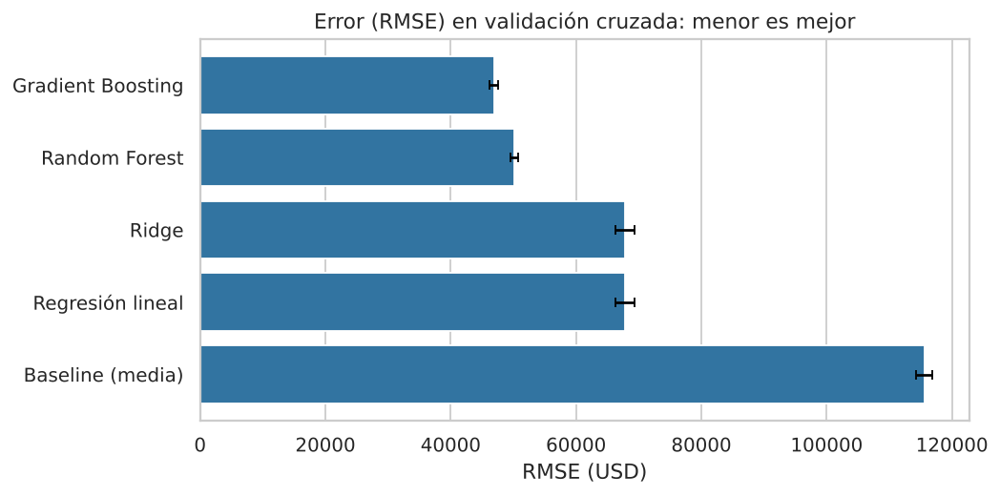
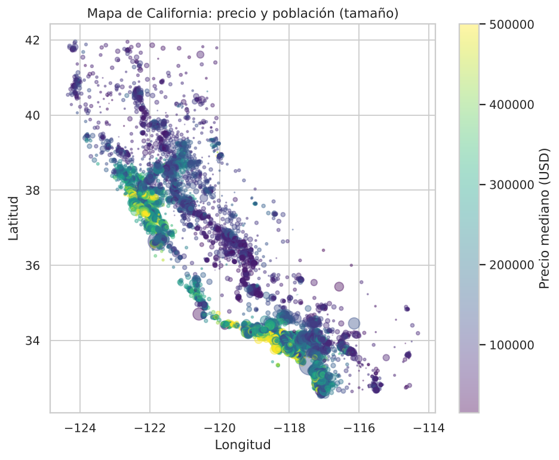
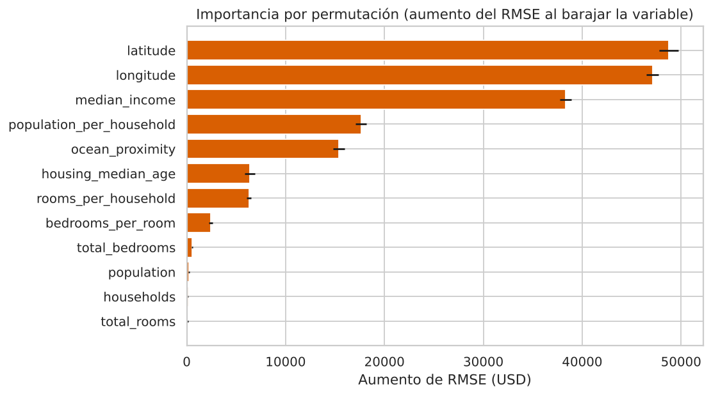

# 🏠 Predicción del precio de vivienda en California

Proyecto de análisis de datos y Machine Learning de punta a punta: limpieza, análisis exploratorio, estadística descriptiva e inferencial, comparación de modelos de regresión, ajuste de hiperparámetros e interpretación.

**Resultado principal:** un modelo de Gradient Boosting que explica ≈ **85 % de la variabilidad** del precio (R² = 0,85) con un error absoluto medio de ≈ **29 000 USD** sobre datos no vistos, frente a ≈ 90 000 USD de un modelo base que predice siempre la media.

## Contenido

- 📓 **Notebook explicado paso a paso:** [`notebooks/analisis_vivienda.ipynb`](notebooks/analisis_vivienda.ipynb)
- 🐍 **Código modular reproducible:** carpeta [`src/`](src) y script [`run_all.py`](run_all.py)
- 📈 **Figuras y tablas generadas:** [`reports/`](reports)
- 📚 **Guía de aprendizaje y cómo subir a GitHub:** [`docs/guia_aprendizaje.md`](docs/guia_aprendizaje.md)

## Datos

Dataset *California Housing* (censo de 1990, Pace & Barry, 1997): 20 640 distritos censales con 10 variables (ubicación, ingreso mediano, tamaño y antigüedad de las viviendas, cercanía al océano) y el valor mediano de la vivienda como variable objetivo. La copia usada proviene del repositorio público [ageron/handson-ml2](https://github.com/ageron/handson-ml2/tree/master/datasets/housing).

## Metodología

1. **Calidad de datos:** nulos (solo `total_bedrooms`, 1 %), tipos, valores censurados (4,7 % de precios topados en 500 001 USD).
2. **Feature engineering:** habitaciones por hogar, proporción de dormitorios, personas por hogar.
3. **EDA:** distribuciones, asimetría, correlaciones, mapa geográfico de precios, comparación por categorías.
4. **Estadística:** descriptiva, correlaciones de Pearson/Spearman, intervalos de confianza al 95 %, ANOVA, Kruskal-Wallis, t de Welch con tamaño del efecto (d de Cohen) y regresión OLS con errores robustos (HC3).
5. **Machine Learning:** separación train/test previa a cualquier ajuste, `Pipeline` de preprocesamiento (imputación, estandarización, one-hot) para evitar fuga de datos, validación cruzada de 5 folds, búsqueda aleatoria de hiperparámetros, importancia por permutación.

## Resultados

Métricas en el set de prueba (20 % de los datos, nunca usado para entrenar ni ajustar):

| Modelo | RMSE (USD) | MAE (USD) | R² |
|---|---:|---:|---:|
| **Gradient Boosting (ajustado)** | **44 703** | **29 233** | **0,848** |
| Gradient Boosting | 46 260 | 30 579 | 0,837 |
| Random Forest | 49 696 | 31 885 | 0,812 |
| Regresión lineal | 69 127 | 49 645 | 0,635 |
| Ridge | 69 135 | 49 652 | 0,635 |
| Baseline (media) | 114 486 | 90 606 | 0,000 |



### Hallazgos

- **La ubicación y el ingreso dominan el precio.** Latitud, longitud e ingreso mediano son las variables más importantes; la correlación de `median_income` con el precio es r ≈ 0,69.
- **Los modelos no lineales superan claramente a los lineales** (RMSE ≈ 45 000 vs ≈ 69 000 USD).
- **La cercanía al océano marca una diferencia enorme:** ANOVA y Kruskal-Wallis con p < 0,001; entre distritos del interior y a menos de una hora del océano, d de Cohen ≈ −1,24 (efecto muy grande).
- **Las variables derivadas aportan:** `population_per_household` es la cuarta más importante.

| Mapa de precios | Importancia de variables |
|---|---|
|  |  |

## Limitaciones

- Datos de **1990**: útil para aprender y demostrar metodología, no para decisiones del mercado actual.
- **Censura:** el 4,7 % de los distritos tiene el precio topado en 500 001 USD, lo que distorsiona el error en viviendas caras (se aprecia en el gráfico de residuos).
- La unidad de análisis es el **distrito**, no la vivienda individual.
- Distritos vecinos se parecen (autocorrelación espacial); la validación aleatoria puede ser algo optimista frente a una validación por zonas.
- La categoría `ISLAND` tiene solo 5 observaciones: no permite conclusiones fiables.

## Cómo reproducirlo

```bash
git clone https://github.com/<tu-usuario>/proyecto-ml-vivienda.git
cd proyecto-ml-vivienda

python -m venv .venv
source .venv/bin/activate        # En Windows: .venv\Scripts\activate
pip install -r requirements.txt

python run_all.py                # genera figuras, tablas y el modelo (≈ 1 minuto)
jupyter notebook notebooks/analisis_vivienda.ipynb
```

## Estructura

```
proyecto-ml-vivienda/
├── data/raw/housing.csv          # datos originales (no se modifican)
├── notebooks/analisis_vivienda.ipynb
├── src/
│   ├── config.py                 # rutas y constantes
│   ├── data.py                   # carga, calidad, feature engineering
│   ├── eda.py                    # figuras del análisis exploratorio
│   ├── stats.py                  # estadística descriptiva e inferencial
│   └── models.py                 # pipeline de ML, evaluación, importancia
├── reports/figures/              # gráficos
├── reports/tables/               # tablas de resultados (CSV y resumen OLS)
├── models/mejor_modelo.joblib    # modelo final entrenado
├── docs/guia_aprendizaje.md
├── run_all.py
└── requirements.txt
```

## Próximos pasos

- Usar `log(precio)` como variable objetivo o excluir los distritos topados.
- Validación espacial (agrupar por zonas geográficas).
- Interpretabilidad con SHAP y variables adicionales (distancia a grandes ciudades).

## Datos y licencia

El dataset es de uso público y se incluye con fines educativos. Antes de publicar, añade un archivo `LICENSE` de tu elección (por ejemplo MIT para el código).
